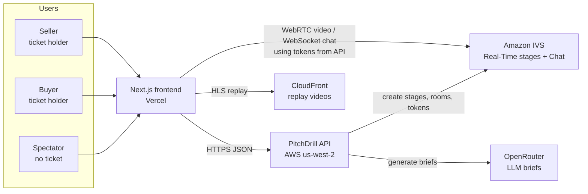
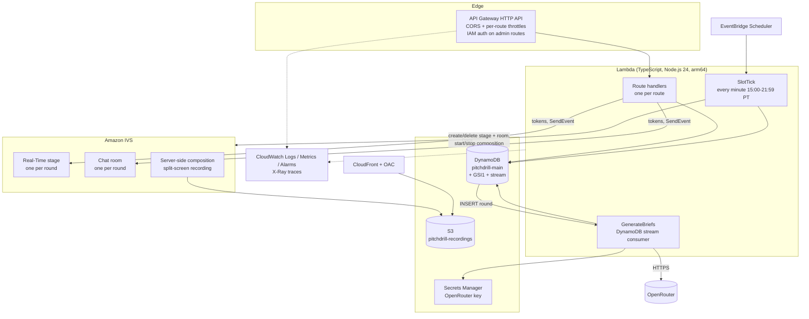
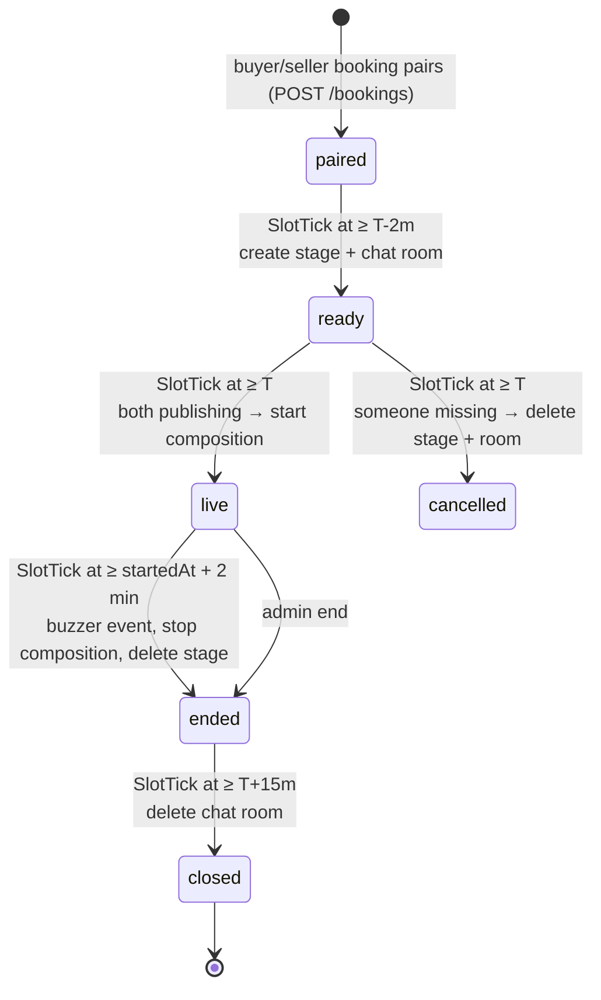
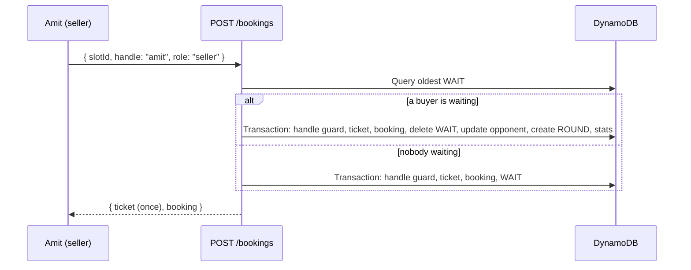
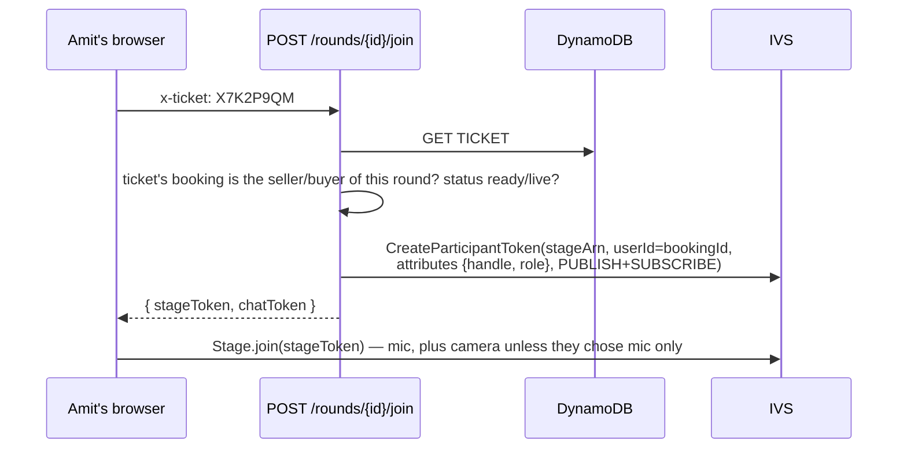

# PitchDrill Architecture

Status: the full backend (booking, round lifecycle, briefs, live video/chat tokens, votes, replays, comments, reports, admin) is deployed (2026-10-15). Public routes are open (no authorizer); admin routes are IAM-only.

## 1. System Context

Our API never carries video or chat traffic. It checks who you are (ticket or anonymous voter ID) and hands out IVS tokens; browsers then talk to IVS directly.

## 2. AWS Components

All of it is one CDK stack, `PitchDrillBackendStack` (`infra/lib/backend-stack.ts`), production only.

## 3. Decisions

| Area | Decision |
|---|---|
| Language | TypeScript everywhere. Bun for install, tests, bundling and the local dev server; Lambdas run on Node.js 24 (arm64). |
| Dependency injection | None. Modules export what they need (e.g. the DynamoDB client). Tests use DynamoDB Local and `mock.module` from `bun:test` for IVS/OpenRouter. |
| Compute | One Lambda per route behind an API Gateway HTTP API, plus `SlotTick` (scheduled) and `GenerateBriefs` (stream). |
| Database | DynamoDB single table + one GSI, on-demand, point-in-time recovery, retained and deletion-protected. See `data_model.md`. |
| Identity | No accounts. Booking returns a random ticket once; only its SHA-256 hash is stored. Spectators are identified by a random `voterId` in localStorage plus a nickname typed once. |
| IAM | Least-privilege `.grant*()`. IVS has no grant methods: use `addToRolePolicy` scoped to exact actions and `arn:aws:ivs:us-west-2:<account>:stage/*` / `room/*` (built with `Stack.formatArn`), with a comment. |
| API exposure | Public routes have no authorizer (opened 2026-10-15 for local frontend development; per-route throttles are the only abuse limit). Admin routes stay IAM-only forever. |
| Rate limiting | HTTP API per-route throttles (all users combined). Default 50 rps / burst 100; `POST /bookings` 10/20; reads 20/40; votes/comments/chat tokens 20/40; reports 5/10. |
| CORS | `http://localhost:3000` and `https://pitchdrill-azure.vercel.app` (Vercel production). |
| Live video | IVS Real-Time: one stage per round. Seller/buyer get PUBLISH+SUBSCRIBE tokens; spectators SUBSCRIBE-only (~0.3s latency). Rounds are audio only for now (players join with their mic; the camera code stays for later); publishing audio alone counts as present. |
| Recording | IVS server-side composition (grid layout, split screen) to S3, served via CloudFront (OAC). |
| Chat | IVS Chat: one room per round. Spectators get SEND_MESSAGE tokens with their nickname; participants get receive-only tokens. Server events (round started, buzzer, tally) are sent with `SendEvent`. |
| Briefs | OpenRouter, random product, generated when a round is paired (DynamoDB stream). Model ID is the CDK constant `OPENROUTER_MODEL` = `anthropic/claude-haiku-5.5` (chosen by the user). Fallback product list if generation fails. |
| No-shows | The round goes live as soon as both sides are publishing at or after T (the tick before T polls every 2 s). If either is still missing at T+1m, it is cancelled (`no_show`). |
| Votes | One per `voterId` per round, "Sold" / "Not sold", open from the buzzer forever (replays too). Tally always visible, broadcast live. |
| Moderation | `POST /rounds/{id}/reports` is public. Admin routes (IAM): list reports, end a live round, hide a replay. No admin UI. |
| Logging | Powertools Logger (JSON + request ID), Tracer (X-Ray), Metrics (EMF). 1-month retention. Alarms named by user impact, console only. |
| Frontend | Next.js App Router on Vercel, MUI with `sx` props, Bun. |

## 4. Slot and Round Lifecycle

Slots: every 15 minutes, 4:00–8:45 PM `America/Los_Angeles`. Bookable from 7 days ahead until 5 minutes before start (T).

Timeline for one slot:

| Time | What happens |
|---|---|
| Booking | Pairing first-come-first-serve; `ROUND` created with status `paired`. Stream → `GenerateBriefs`. |
| T-5m | `SlotTick`: pair leftover waiters (fixes simultaneous-booking race), mark the rest `no_opponent`, retry missing briefs (fallback list at this point, never repeating a product within the slot). Briefs become readable (`GET /rounds/{id}/brief`, each side sees only its own). Status stays `paired`. |
| T-2m | `SlotTick`: create stage + chat room for each paired round. Status `ready`. Participants and spectators can join. Opening late keeps billed IVS participant-minutes down; ticks fire ~24 s past the minute, so players get ~1.5 min to join. |
| T … T+1m | `SlotTick`: the tick in the minute before T waits for T, then polls the stage every 2 s for up to 50 s from its own start (under the tick interval, so polls never overlap); later ticks check once. Clients count 3-2-1 down to T. Both participants publishing → `StartComposition` (store `compositionArn` + `recordingPrefix`), `startedAt`, status `live`, `round_started` chat event. Still missing at T+1m → status `cancelled` (`no_show`), `round_cancelled` event, stage + room deleted. |
| startedAt + 2 min | Client shows the buzzer. The tick before the buzzer (within 15 s) waits for it, then: `buzzer` event, `StopComposition`, delete stage, status `ended`, `endedAt`. Voting opens. |
| T+15m | `SlotTick`: delete chat room, status `closed`. Once `<recordingPrefix>/events/recording-ended.json` exists in S3, set `recordingPath` and list it in the replay feed. |

`SlotTick` runs every minute (no reserved concurrency: the account limit is 10, so overlapping ticks are possible); transitions can lag up to a minute. Every transition MUST be idempotent (conditional updates on `status`). Logic lives in `backend/src/lib/lifecycle.ts`.

## 5. API

All responses are JSON. Errors are `{ error: { code, message } }` with a user-safe message.

| Route | Auth | Purpose | Task |
|---|---|---|---|
| `GET /slots` | public | Bookable slots for the next 7 days with waiting counts | 001 |
| `POST /bookings` | public | `{ slotId, handle, role }` → `{ ticket, booking }` (ticket shown once) | done / 001 |
| `GET /ticket` | `x-ticket` | The booking for a ticket, incl. opponent and round | done / 001 |
| `GET /rounds/live` | public | Rounds in `ready`/`live` for the current slot | 009 |
| `GET /rounds/{roundId}` | public | Round status, handles, times, tally, replay URL; product + seller sheet from `live`, buyer persona from `ended` | 009 |
| `GET /rounds/{roundId}/brief` | `x-ticket` | Your own side's brief, from T-5m | 009 |
| `POST /rounds/{roundId}/join` | `x-ticket` | Participant stage token (PUBLISH+SUBSCRIBE) + receive-only chat token | 009 |
| `POST /rounds/{roundId}/watch` | public | `{ voterId }` → SUBSCRIBE-only stage token | 009 |
| `POST /rounds/{roundId}/chat-token` | public | `{ voterId, nickname }` → SEND_MESSAGE chat token | 010 |
| `POST /rounds/{roundId}/votes` | public | `{ voterId, vote }`, one per voter | 011 |
| `GET /replays` | public | Recent replays, newest first, paginated | 012 |
| `GET /rounds/{roundId}/comments` | public | Replay comments, oldest first, paginated | 012 |
| `POST /rounds/{roundId}/comments` | public | `{ voterId, nickname, text }` | 012 |
| `POST /rounds/{roundId}/reports` | public | `{ voterId, reason }` | 013 |
| `GET /admin/reports` | IAM | Recent reports | 013 |
| `POST /admin/rounds/{roundId}/end` | IAM | End a live round now | 013 |
| `POST /admin/rounds/{roundId}/hide` | IAM | Hide a replay (feed + round page) | 013 |

Routes are declared once in `backend/src/routes.ts` (TASK-002) and read by both the CDK stack and the local dev server.

## 6. Key Flows

### Booking and pairing

### Ticket → booking → round → stage token

### Spectator

`POST /rounds/{id}/watch` with `voterId` → SUBSCRIBE-only token. Chat: `POST /rounds/{id}/chat-token` with `voterId` + nickname. Votes: `POST /rounds/{id}/votes`; the handler broadcasts the new tally with chat `SendEvent` while the room exists.

## 7. Local Development

- DynamoDB Local in Docker (`amazon/dynamodb-local`, port 8000).
- `backend` dev server (`bun run dev`, port 4000) serves every route in `routes.ts` against DynamoDB Local, plus dev-only `POST /dev/tick?now=<iso>` to run `SlotTick` at any time. IVS and OpenRouter calls go to the real services with your local AWS profile.
- Frontend dev uses `NEXT_PUBLIC_API_URL=http://localhost:4000`.

## 8. Security

- Raw tickets are returned once and never stored. Lookups are by hash key.
- IVS publish tokens only for the ticket holder of that round's seller/buyer booking. Spectator tokens are SUBSCRIBE-only; chat tokens for participants have no capabilities (receive only).
- Briefs are served per side before the round; the buyer persona is never returned to the seller while the round can still be played. Publicly, the seller sheet appears once the round is live and the persona only after the buzzer (players can read chat, so an earlier reveal could leak the persona to the seller).
- No AWS credentials in the frontend. OpenRouter key only in Secrets Manager, read by `GenerateBriefs` and `SlotTick`.
- User text (handles, nicknames, comments, report reasons) is length-limited and validated server-side; React escapes it on render.
- Replays of hidden rounds are not listed and `GET /rounds/{id}` returns 404 for them.

## 9. Observability

- Every handler goes through `handle()` in `backend/src/lib/http.ts` (request-ID logging, `{ error }` responses, metrics flush). Non-HTTP Lambdas (`SlotTick`, `GenerateBriefs`) call `logger.addContext` and `metrics.publishStoredMetrics` themselves.
- Metrics (namespace `PitchDrill`): `BookingCreated`, `RoundPaired`, `RoundStarted`, `RoundCancelled`, `BriefGenerated`, `BriefFallbackUsed`, `VoteCast`.
- Alarms (named by user impact): users cannot see schedule / book / open tickets / getting server errors (phase 1); rounds not starting (`SlotTick` errors), briefs failing (`BriefFallbackUsed`), cannot join rounds, cannot vote.
