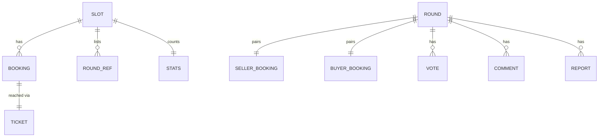

# PitchDrill Data Model

One DynamoDB table, `pitchdrill-main` (on-demand, PITR, deletion-protected, retained). Keys are strings: `PK`, `SK`. One GSI (`GSI1`) for the replay feed. A DynamoDB stream (`NEW_IMAGE`) feeds `GenerateBriefs`.

Phase 1 (deployed) stores the full round under the slot partition. TASK-001 moves it to its own `ROUND#` partition as described here.

## Entities

- **Slot**: a start time (UTC ISO string, e.g. `2026-10-14T23:00:00.000Z`). Not stored as an item; it is the partition key of its bookings.
- **Booking**: one person's seat in a slot (handle + role). Reached only via its ticket.
- **Ticket**: random token returned once at booking; stored only as SHA-256 hash.
- **Round**: one seller booking + one buyer booking in a slot. Holds IVS resources, briefs, votes tally, recording.
- **Vote / Comment / Report**: belong to a round, identified by an anonymous `voterId` (random UUID in the browser's localStorage).

## Item Layout

### Slot partition — `PK = SLOT#<slotId>`

| SK | Attributes | Written by |
|---|---|---|
| `STATS` | `sellers`, `buyers` (seats taken, capped at 4 each by a condition on the `ADD`; live), `waitingSellers`, `waitingBuyers`, `rounds` (numbers, `ADD`; TASK-001) | `POST /bookings`, `SlotTick` sweep |
| `BOOKING#<bookingId>` | `slotId`, `bookingId`, `handle`, `role` (`seller`\|`buyer`), `createdAt`, `status` (`waiting`\|`paired`\|`no_opponent`), `roundId?`, `opponentHandle?` | `POST /bookings`, `SlotTick` |
| `WAIT#<role>#<createdAt>#<bookingId>` | `bookingId`, `handle` | `POST /bookings` (put/delete), `SlotTick` (delete) |
| `HANDLE#<lowercase handle>` | — (uniqueness guard, conditional put) | `POST /bookings` |
| `ROUND#<roundId>` | `roundId` (index of rounds in the slot) | `POST /bookings`, `SlotTick` sweep |

### Round partition — `PK = ROUND#<roundId>`

| SK | Attributes | Written by |
|---|---|---|
| `META` | see below | many |
| `VOTE#<voterId>` | `vote` (`sold`\|`not_sold`), `createdAt` | `POST /rounds/{id}/votes` (conditional put) |
| `COMMENT#<createdAt>#<commentId>` | `commentId`, `voterId`, `nickname`, `text`, `createdAt` | `POST /rounds/{id}/comments` |
| `REPORT#<createdAt>#<reportId>` | `reportId`, `voterId`, `reason`, `createdAt` | `POST /rounds/{id}/reports` |
| `REPORTER#<voterId>` | — (one report per voter per round, conditional put) | `POST /rounds/{id}/reports` |

`META` attributes:

| Attribute | Type | Notes |
|---|---|---|
| `roundId`, `slotId` | string | |
| `sellerBookingId`, `sellerHandle`, `buyerBookingId`, `buyerHandle` | string | |
| `status` | `paired`\|`ready`\|`live`\|`cancelled`\|`ended`\|`closed` | transitions in `architecture.md` §4; always conditional on the previous status |
| `cancelReason?` | `no_show`\|`admin` | |
| `stageArn?`, `chatRoomArn?`, `compositionArn?` | string | set by `SlotTick` |
| `startedAt?`, `endedAt?` | ISO string | |
| `briefs?` | map `{ product: { name, price, tagline }, seller: string, buyer: string, source: "openrouter"\|"fallback" }` | set by `GenerateBriefs` / `SlotTick`; never returned whole to clients |
| `votesSold`, `votesNotSold` | number | `ADD` on each vote |
| `recordingPath?` | string | S3 key of the HLS multivariant playlist |
| `hidden?` | boolean | admin hide |
| `GSI1PK?`, `GSI1SK?` | `"REPLAY"`, `endedAt` | present only when the replay is listable (recording ready, not hidden) |

### Ticket — `PK = TICKET#<sha256(ticket)>`, `SK = TICKET`

`slotId`, `bookingId`.

### Admin report index — `PK = REPORTS`, `SK = <createdAt>#<roundId>#<reportId>`

`roundId`, `reason`, `voterId`. Written in the same transaction as the round's `REPORT#` item so admins can list recent reports across rounds.

## GSI1 (replay feed)

| Key | Value |
|---|---|
| `GSI1PK` | `"REPLAY"` |
| `GSI1SK` | `endedAt` (ISO) |

Query `GSI1PK = "REPLAY"`, `ScanIndexForward = false`, `Limit` + `ExclusiveStartKey` for pagination. Projection: ALL.

## Access Patterns

| # | Pattern | Operation |
|---|---|---|
| 1 | Bookable slots with waiting counts | `BatchGetItem` `SLOT#<id>/STATS` for each bookable slot (≤ 160, in chunks of 100) |
| 2 | Oldest waiting opposite role in a slot | `Query PK=SLOT#<id>, begins_with(SK, "WAIT#<role>#")`, `Limit 1` |
| 3 | Book + pair | `TransactWriteItems` (handle guard, ticket, booking, WAIT delete/put, opponent update, round `META`, slot `ROUND#` ref, `STATS`) |
| 4 | Booking by ticket | `GetItem TICKET#<hash>` → `GetItem SLOT#/BOOKING#` |
| 5 | Rounds in a slot (tick, live list) | `Query PK=SLOT#<id>, begins_with(SK, "ROUND#")` → `BatchGetItem ROUND#<id>/META` |
| 6 | Round detail | `GetItem ROUND#<id>/META` |
| 7 | Cast vote | `TransactWriteItems`: put `VOTE#<voterId>` (`attribute_not_exists`) + `ADD` tally on `META` |
| 8 | Comments of a round | `Query PK=ROUND#<id>, begins_with(SK, "COMMENT#")` |
| 9 | Replay feed | `Query GSI1` |
| 10 | Recent reports | `Query PK=REPORTS`, newest first |

## Limits and Validation

| Field | Rule |
|---|---|
| `handle` | `^[A-Za-z0-9_]{3,20}$`, unique per slot, case-insensitive |
| seats per slot | at most 4 sellers and 4 buyers (so at most 4 rounds); the 5th booking of a role gets `409 slot_full` |
| `nickname` | 2–20 chars, trimmed, letters/numbers/spaces/`_-.` |
| `voterId` | UUID v4 |
| comment `text` | 1–500 chars, trimmed |
| report `reason` | 1–300 chars, trimmed |
| `vote` | `sold` \| `not_sold` |
